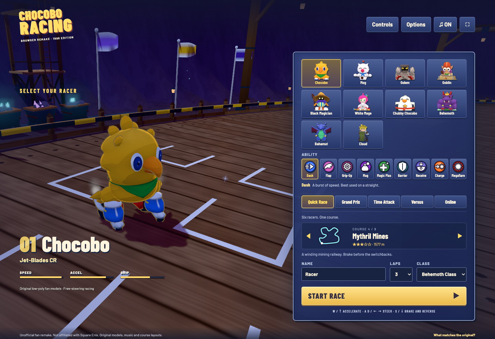
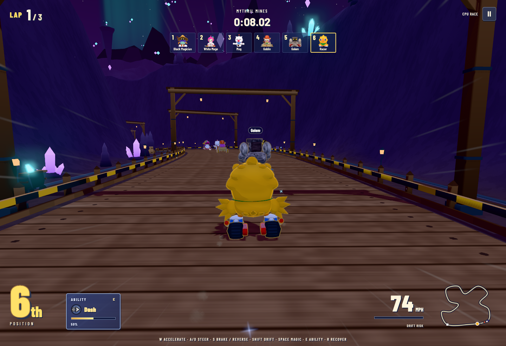

# Chocobo Racing browser remake

A free, open-source racing game that aims to recreate the feel of old-school games like Chocobo Racing using modern web technologies. Built with TypeScript, Three.js, WebGL, Node.js and Socket.IO, it runs in the browser and supports local races and private online rooms.

This playable, unofficial fan interpretation of the 1999 PlayStation racer has free driving, nine racers (the eight Story racers with their vehicles, plus Bahamut on his own wings) and an original-style Magic Stone system.

[Repository](https://github.com/SainyTK/chocobo-racing-threejs) · [MIT license](LICENSE)

[Play in your browser](https://chocobo-racing-threejs-production.up.railway.app/), or follow the instructions below to play locally.

The public server uses Railway's free credits. It can sleep when idle and may be unavailable when credits run out. Rooms disappear when the server sleeps, restarts or deploys.

This is not an identical port. Models, music, animations, maps and physics tuning are newly authored. Character and course names reference Square Enix's game. No original game files are bundled or required. The project is not affiliated with Square Enix.

## Screenshots

Captured from the running game with Orca's embedded browser.

### Racer selection



### Racing in Mythril Mines



## Play

Requires Node.js 22.12 or newer and WebGL 2.

```sh
git clone https://github.com/SainyTK/chocobo-racing-threejs.git
cd chocobo-racing-threejs
npm ci
npm run dev
```

Open http://localhost:3000.

- Quick Race: six racers on the selected course, with CPU opponents.
- Grand Prix: four courses, cumulative points, changing grids and a final champion.
- Time Attack: solo racing without stones. Your best race saves a Phantom Racer in this browser.
- Versus: one-on-one racing against a selected CPU rival.
- Online: private six-player rooms. Empty positions use CPU racers. Share the six-character code or invite link.

Choose among nine racers and nine courses.
Bahamut, the original's secret final opponent, is unlocked from the start: he flies instead of driving, with Goblin's top speed, good acceleration and loose grip.
Each racer starts with its own ability, and you can pick any other ability for yourself. CPU racers always use their own. Lap count is configurable from one to three. Grand Prix starts on your selected course and continues through the next three in course order.

The CLASS setting sets the challenge for Quick Race, Grand Prix, Versus and online rooms.
Chocobo Class has relaxed rivals who misread hazards and rarely take shortcuts.
Behemoth Class, the default, has rivals who brake and drift well.
Bahamut Class makes every racer 10% faster, and its rivals drive at the limit and take most shortcuts.
CPU racers get a small speed lift when they fall far behind the leading human and are held back a little when far ahead.
Within 30 m of that human there is no lift, so catch-up never carries a CPU past you.
Time Attack has no class setting.
The online host's class applies to the whole room.

### Driving

Manual acceleration is on by default. You must steer around corners. The game does not guide your heading along the road. Options includes auto-accelerate, which does not steer for you.

| Action | Keyboard | Touch | Standard gamepad |
| --- | --- | --- | --- |
| Accelerate | W or up arrow | Hold DRIVE | Right trigger |
| Steer | A/D or left/right arrows | Left thumb on the floating steering pad | Left stick |
| Brake | S or down arrow | BRAKE | Left trigger |
| Reverse | X | Reverse button | B |
| Drift | Shift while steering, or accelerator + brake | DRIFT, or DRIVE + BRAKE | A |
| Cast latest stone | Space | MAGIC | X |
| Ability | E | Ability button | Y |
| Recover | R | Recover button | - |
| Look behind | B | Look-behind button | - |
| Race menu | Escape | Pause button | - |

Racers grip hard enough to take most medium corners near top speed, but a corner taken too fast runs wide.
Lift, brake, or tap the brake while steering to turn tighter.
Each tap, up to three in a row, tightens the turn further for a moment and costs a little speed.
A drift is a short, tight slide that also costs speed, so long slides lose time.
After 1.9 s of continuous drifting the racer spins out; there is no release turbo.
Release the pedals during an over-drift spin, then press accelerate to perform a Spin Dash.
A timed accelerator press just before GO gives a dash start.

Boosts start with an instant kick, and the extra speed bleeds away over about a second and a half once the boost ends.
Boost pads last 1.6 s.
Grass and rough ground slow you over about half a second.
Wall hits cost speed in proportion to how hard you hit, and Grip-Up glances off walls.
In bumps, bigger racers shove smaller ones: Chubby Chocobo, Behemoth and Golem are the heaviest.

On a touch screen, put your left thumb down anywhere on the lower left and slide it left or right to steer.
The steering pad appears where your thumb lands and returns to the corner when you lift it.
The right thumb rests on DRIVE in the bottom-right corner, with DRIFT and BRAKE stacked to its left.
You can roll your thumb between DRIVE, DRIFT and BRAKE without lifting it.
DRIFT keeps accelerating, so sliding onto it from DRIVE keeps you driving.
MAGIC, which previews your stones, sits above DRIVE, and the ability button sits above DRIFT.
Look behind, recover and reverse are small buttons in a row above them, or beside the ability button on short landscape phones.
With auto-accelerate on, DRIVE shows AUTO and stays lit.
A held key overrides touch steering.

### Magic Stones

Stones lie on the road in rows of three or four coloured lanes, and each colour is one spell, so steer into the colour you want.
Each course uses the stone set the original introduced in its Story chapter.
Cid's Test Track and Moogle Forest have only Haste and "?" stones, The Ancient Gate adds Fire, and each later course adds one more: Ice, Thunder, Mini, Reflect and Doom.
Fantasia, the Bahamut stage, lays every type, and it is the only course with Ultima stones on the road.
A black "?" stone, a dark orb with a white question mark as in the original, rolls a random spell.
Racers in the back half of the field get stronger random spells, and only they can roll Ultima from one.
A taken stone comes back after 3.5 s.

You hold up to three stones, trailing in a line behind your racer.
A stone that matches your latest stack merges into it for a stronger spell, up to level three, but every stone still takes a place until you cast.
A level three stack fills all three HUD slots.
Level two and three stacks glow, and level three blazes.
The latest stack casts first, at its full level.
Reflect and Doom never merge.
Drive into a rival's trailing stack to take it.

Single-target spells pick their victim by race progress, so from first place they hit second place.

| Spell | Level 1 | Level 2 | Level 3 |
| --- | --- | --- | --- |
| Fire | Flies straight ahead | Homes on the racer ahead | A homing fireball at every racer ahead, or at everyone from first place |
| Ice | Drops an ice sheet behind you | Drops six sheets | Freezes every rival |
| Thunder | Spins out the racer ahead | Crashes the racer ahead | Strikes every rival |
| Haste | 2 s boost | 4 s boost | 7 s boost |
| Mini | Shrinks the racer ahead by 25% | By 50% | Shrinks every rival |
| Ultima | Spins out every rival | Crashes every rival | The longest crash, for every rival |

Mini also cuts top speed by the same share and stacks on a racer who is already small.
Shrunken racers can be squashed by a bump.
Black Magician's cloud, White Mage's carpet, Bahamut and anyone flying with Flap pass over ice sheets.
Doom puts a 10 s curse on the racer ahead, and bumping a rival passes it on.
After a pass, both racers' contacts pause for 2 s, so the curse cannot bounce straight back.
Reflect protects automatically while held, and a cast Reflect shields you for 5 s.
It returns level one and two spells to the caster, and only blocks level three spells, Ice and Ultima.

Hits come in three tiers: a 1 s spin-out, a 1.6 s crash and a 2.4 s heavy crash, and Ultima III is longer still.
Every level three spell is a heavy crash.
After any crash the racer blinks and cannot be hit for 2.5 s, so hits never chain.

### Abilities

Every ability gauge starts empty and fills at a constant rate.

| Ability | Racer | Recharge | Effect |
| --- | --- | --- | --- |
| Dash | Chocobo | 16 s | A 2 s boost |
| Flap | Mog | 11 s | Fly over ice and rough ground for 5 s |
| Grip-Up | Golem | 11 s | Extra grip, steering and acceleration for 7 s |
| Mug | Goblin | 18 s | Takes one stone from the best placed rival who holds one, or gives a random stone; it waits while your inventory is full |
| Magic Plus | Black Magician | 20 s | Automatically adds a level to your latest stack |
| Barrier | White Mage | 16 s | Automatically raises a shield for 4 s or until it blocks one hit |
| Receive | Chubby Chocobo | 18 s | Automatically catches the next spell that hits you as a stone of the same level, if there is room |
| Charge | Behemoth | 14 s | A 1 s boost that spins out rivals you ram |
| Megaflare | Bahamut | 80 s | Flare shots rain down for 1.5 s, then every rival is thrown into the air and crashes for 1.6 s. Barrier, Reflect and Receive cannot stop it; only the post-crash safe window does |

CPU racers cast only when a spell has a valid target, and each character has its own habit.
Chocobo and Chubby Chocobo hoard stones, Golem, Goblin and Black Magician build them up, Mog and White Mage cast quickly, Behemoth specialises in Fire, and Bahamut builds Fire like Golem and Goblin.
A CPU Bahamut fires Megaflare as soon as one rival can be hit.
The original charges Megaflare in 45 s; here that won Bahamut 63% of all-CPU races, so it charges in 80 s and stalls for a normal crash's time.

### Courses

Each course has its own mix of boost pads, surface patches, jumps, railings, shortcuts and timed hazards.
Mud and goo slow you down, and ice, oil and icing make you slide.
Timed hazards show a pulsing striped mark on the road before they strike, and a hit crashes you like a spell.
Ramps throw racers into the air, and a racer more than 2.6 m up clears any hazard.
Shortcuts leave the road at a shallow angle, turn evenly and rejoin at the same angle, and the road wall opens 12 m before each mouth.
A clean line through one gains roughly 0.6 to 1.7 s; Fantasia's walkway gains about 2 to 3 s, but you reach it by dropping off the road edge at a sharp angle and it has no railings.

| Course | Gimmicks |
| --- | --- |
| Cid's Test Track | Four boost pads, a jump ramp on the back straight, an oil slick on the hairpin apex |
| Moogle Forest | A woodland trail shortcut through the double left bend, three mud pools on the apexes |
| The Ancient Gate | A walled side passage on the long right-hander, two stone doors that close the road half at a time |
| Mythril Mines | A hidden rail-bed shortcut with no stones, runaway mine carts crossing the road from tunnel portals |
| The Black Manor | A cage that drops on the sharp left (go wide to slip past), two ghosts sweeping across the hall, a jump over the blood pond |
| Floating Gardens | A ramp over a 13 m gap between islands, a railless sky-bridge shortcut, an ice slick on the hairpin |
| Gingerbread Land | A slippery syrup shortcut after the first right turn with a lone "?" stone halfway along, a candy ramp, giant cutlery stuck in the road, an icing slick after the tunnel |
| Vulcan-O Valley | Four falling boulders on the racing line with shadow warnings, three lava geysers at the edges of bends |
| Fantasia | Pits on both sides with a railing on one side at most, switching sides through Leviathan's coils; a railless blue-lit walkway below the road edge that skips the far-left spike, reached by dropping off the edge; a walled tunnel; rolling hills before the last turns; Ramuh's lightning as scenery, as in the original |

Leaving a cliff edge, a sky bridge or landing in a gap is a fall.
On Fantasia, where the course hangs over the void, a railing stops you like a wall, and every edge without one is a drop.
The Floating Gardens ramp always carries a racer over the gap; only a spell hit in mid-air drops a racer in.
A rescue just before a gap restarts the racer with a run-up.
The tightest hairpins are eased slightly at the apex, so the road's inside edge never folds over itself, and standings, lap crossings and finish times stay correct for a racer on the inside line.

### Camera and HUD

The chase camera rides low behind the racer.
It leans into drifts, spins and wall bounces, pulls back briefly when a boost starts and jolts lightly on wall hits.
The field of view widens with speed and further on boosts, and speed lines streak across the screen near top speed.
Rivals close to the camera fade out so they never fill the screen.
On portrait screens the camera sits higher and closer and looks further down the road, so the racer sits above your thumbs and the road ahead fills the middle; tablets in portrait get a blend of the two framings.

A portrait strip at the top shows the race order.
Portraits slide when places change, bob when that racer casts and spin while it is crashed.
One callout at a time announces the moment that matters most, and between events it shows your lasting status, such as a Doom countdown, wrong way or a missed checkpoint.
After you cross the line, a local race plays in slow motion, then an orbit shot circles your racer and a podium shows the top three before the results.
Online races skip the slow motion, and Time Attack skips the podium.
Escape, Enter, Space or a click skips to the next shot.
Finished racers roll to a stop at the roadside.

Local menus pause the race. Online rooms continue running. Disconnected online racers get CPU control and can reconnect within 60 seconds, including after a page reload.

### Music

Each of the nine courses has its own newly composed, multi-part synthesized music loop inspired by the 1999 soundtrack's course themes. Menus use a separate tune. Local race pauses stop the music; online race menus do not pause it. The sound toggle controls music, effects and engines.

Sound effects are synthesized too.
Each vehicle has its own engine hum, and you also hear the nearest rival's engine.
Every spell has cast and impact sounds by level, alongside sounds for bumps, walls, boosts, pickups, steals, falls, laps and the countdown.
Each character has short voice barks when you select it and when it casts, gets hit, overtakes or wins.
Rival sounds within 90 m play quieter and panned toward where they happen.

Music starts after a click, tap or driving key because browsers require a user gesture. No original recordings or transcribed game melodies are bundled. See [stage music references and composition notes](docs/stage-music-reference.md).

## Play on another device

The server listens on `0.0.0.0`. Use this computer's LAN IP on devices on the same network, for example `http://192.168.1.20:3000`. Open the LAN address before copying an invite. A localhost link cannot reach another computer. Allow the port through the host firewall.

For temporary internet play without deployment, use the tunnel setup below. For permanent hosting, deploy the Node server on a reachable HTTPS host with WebSocket support. Static-file hosting alone is insufficient.

### Test online multiplayer locally with cloudflared

A Cloudflare Quick Tunnel gives this computer's game server a temporary public HTTPS URL. Teammates can join from computers or phones on different networks without deploying to Railway. The host computer must stay awake with the command running. This tests internet play through the host computer and Cloudflare, not the production Singapore Railway route.

Install Node.js 22.12 or newer and [cloudflared](https://developers.cloudflare.com/tunnel/downloads/). Quick Tunnel instructions and limitations are in [Cloudflare's documentation](https://developers.cloudflare.com/tunnel/get-started/quick-tunnels/). On macOS with Homebrew, install it with `brew install cloudflared`.

1. In the repository checkout you want to test, run:

   ```sh
   npm run tunnel
   ```

   Run `npm ci` first if dependencies are not installed. This command checks for cloudflared and a free port, builds the game, starts the production server on port `3219`, and opens the tunnel. No second terminal or manual origin configuration is needed. It uses the server's same-origin check for multiplayer, overriding any inherited `ALLOWED_ORIGINS` setting for this test session.

   To use another port, run `PORT=3000 npm run tunnel`. If the port is occupied, the command stops rather than exposing another server.

2. Copy the actual `https://...trycloudflare.com` URL printed by cloudflared. It changes whenever the tunnel restarts. Keep the command running.

3. Open the same tunnel URL on every device. Choose **Online**, create a room on one device, then join its six-character room code on the others. Open the tunnel URL before copying an invite; a localhost invite does not work on a teammate's phone. With two players, the remaining four racers are CPU-controlled. On a phone, hold DRIVE with your right thumb and steer with your left thumb anywhere on the lower left. MAGIC and the ability button sit above DRIVE, and DRIFT and BRAKE sit next to it. Use mobile data on the phone to test separate internet connections, or the same Wi-Fi for a same-network test through the tunnel.

4. Optionally append `/?netPerf` to the tunnel URL to collect bounded frame/network diagnostics. Do not add `netDelay`, `netJitter` or `netDrop` for a real-connection test. Desktop Chrome's developer console can copy the telemetry with:

   ```js
   copy(JSON.stringify(window.__raceDebug.network))
   ```

   Record the device/browser, graphics setting and connection type alongside the telemetry. Try normal play without diagnostics too. See [multiplayer measurements and test methodology](docs/multiplayer-performance.md).

Share the temporary URL only with the test team; anyone with it can access the local game service. This is a testing tunnel, not permanent hosting. When finished, press Ctrl+C to stop the server and cloudflared. Cancellation during the build also stops the build processes. If the server or tunnel exits unexpectedly, the command stops the other process too. No Railway deployment, paid service or billing change is needed.

## Studio

The studio is an internal viewer for game elements: racers, Magic Stones, spell effects, stage objects, whole courses and music.
Characters include their hit, cast, overtake, win and lose reactions, and the effects preview every spell's cast and hit at each level.

```sh
npm run studio
```

It opens http://localhost:5180 with its own Vite server, separate from the game server.
The production build does not include it.

To listen without opening the game, search for `music` or scroll to the Music category. Select one of the courses or Menu music, then press **Play music**. The menu and the original eight courses each have a **Revised composition** used in the game and a **Previous composition** for before/after review; Fantasia, written after the revision, has only its composition. Choose the variant or press **All variants** to compare them in separate panes. Both versions use the updated instruments, so this compares the composition, not the old synthesizer sound.

Each preview shows the 1999 Chocobo Racing reference track, arranging notes, composition title, tempo, loop length and playback progress, with pause, restart and volume controls. The scores remain newly authored, not copies of the reference recordings. Only the active comparison pane plays audio. Switching to a non-music element stops playback. The toolbar's Pause and Restart also control music; animation speed does not change its tempo. Shared links and page reloads never autoplay. See the [revision brief and sources](docs/music-revision-brief.md).

Search the library with `/` (or Cmd/Ctrl+K), then press Enter to show the highlighted element in the active pane.
Shift+Enter adds it as a new pane.
Compare up to four panes side by side, each with its own element and variant, labelled A to D.
`V` (or "All variants") fills the panes with the variants of the active element, and `[` / `]` step through variants.
Linked cameras turn every pane together, and Restart replays every pane from the same moment.
Variants marked "In game" are what the game currently uses.

The address bar always holds the full comparison, so "Copy link" shares exactly what you see.
"Save image" downloads all panes as one PNG with each pane's letter, element and variant, ready to post for a decision.
Quality switches between the game's High and Low settings.

The Courses category builds a complete course in a pane, lit by its own sky, fog and sun.
"Race camera lap" drives a Chocobo round the course behind the game's chase camera; drag to look around it and scroll to pull back.
"Aerial overview", "Start line" and the six "Trackside" views orbit fixed points of the course.
Each gimmick also has its own variant, such as "Shortcut at 590 m", seen from a racer's chase-camera height 24 m before it.
"Prop sheet" lays out the course's named props side by side with labels, for working on one prop at a time.
Course files hot-reload, so scenery can be built and judged here without starting a race.

To register a new element, add an entry under `studio/elements/` and list it in `studio/registry.ts`.

## Course scenery

Each course's look lives in one file under `src/gfx/stage/courses/`: its sky, fog and light, terrain shape and colour, road surface, start gate colours, ambient particles, a `build` function that places everything else, and a catalog of props for the studio's prop sheet.
`src/gfx/stage/kit.ts` collects props in world space and merges them per 128 m chunk and material layer, so the camera culls whole sections and a course draws in a few hundred calls.
Props are authored as `Parts`: geometry painted per vertex with baked ambient occlusion, on a solid, wind-swayed foliage or glowing layer.
Small dressing marked `detail` disappears on Low quality.
The gimmicks themselves (pads, patches, ramps, gaps, railings, shortcuts and hazards) are simulation data in `shared/track/layouts/`, so the server, client prediction and renderer all read the same layout. Each course file dresses them with matching models.

`npx tsx tests/stage-report.ts [ids] [--props]` prints build time and triangle counts per course, and with `--props` the cost of every catalog prop.
`tests/stage.test.ts` builds every course headless and checks budgets, disposal, Low-quality detail hiding, and that nothing stands on the road or a shortcut between the surface and 9 m overhead, where the chase camera rides. Moving hazard parts are skipped, since they enter the racing line on purpose.
`tests/courses.test.ts` checks that every gimmick sits on its course, that shortcuts leave and rejoin the road at their join angle, and the jump, gap, hazard and shortcut-stone rules.

## Production

```sh
npm run build
ALLOWED_ORIGINS=https://racing.example.com PORT=3000 npm start
```

`ALLOWED_ORIGINS` accepts comma-separated exact origins. Without it, the server accepts matching Origin/Host pairs. Set it explicitly behind a reverse proxy and forward WebSocket upgrades.

```sh
docker build -t chocobo-racing .
docker run --rm -p 3000:3000 \
  -e ALLOWED_ORIGINS=http://localhost:3000 \
  chocobo-racing
```

`GET /health` reports health, rooms and connections. The server is a single process with in-memory rooms. Restarting it clears rooms. Do not run unsynchronized replicas. Public hosting also needs infrastructure rate limiting and monitoring.

## Deployment

The public deployment is a single Railway service in Singapore that serves both `dist/` and the authoritative multiplayer server. The existing Dockerfile builds and starts both. No database is required.

The Railway project is `hearty-analysis`, service `chocobo-racing-threejs`, environment `production`. GitHub auto-deployment is connected to `main`. It uses one replica, `/health` for deployment checks, and idle sleeping. `ALLOWED_ORIGINS` is `https://chocobo-racing-threejs-production.up.railway.app`.

Hosting stays on the free Trial, which automatically reverts to the Free plan with $1 monthly credit [3]. No paid subscription was created. Uptime depends on available credits. Idle sleeping reduces usage but active multiplayer connections can keep the server awake.

Railway detects a repository Dockerfile automatically [1]. Use the repository root, branch `main`, one replica, a public HTTPS domain and healthcheck path `/health`. The server listens on `0.0.0.0` and reads Railway's `PORT` variable [2]. Set `ALLOWED_ORIGINS` to the exact public page origin, without a trailing slash. Add any custom-domain origin as another comma-separated value. Rooms live in memory and disappear on restart or deployment.

Vercel can host the Vite frontend with build command `npm run build` and output directory `dist`. However, this is not a complete multiplayer deployment as written. `src/network.ts` currently connects to the page's own origin. A split Vercel/Railway deployment needs a configurable backend URL and cross-origin Socket.IO configuration on the server, including polling CORS. Vercel preview origins also need an explicit policy. Keep the current long-running simulation and room state on Railway unless the backend is redesigned.

### What to provide before deployment

- Choose Railway-only, or Vercel frontend plus Railway backend. Railway-only needs no frontend/backend split.
- Confirm the Railway workspace, project, environment and service name. Say whether to create a new project or use an existing one, and provide its ID or dashboard URL if it exists.
- Authenticate Railway locally through its CLI, or connect Railway to GitHub and authorize access to this repository. Registration alone does not grant deployment access.
- Specify the region nearest your players, an approved monthly hosting budget, and whether pushes to `main` should deploy automatically.
- Choose a provider-generated domain or supply your custom domain and confirm you can edit its DNS.
- If using Vercel, also supply the team/account scope and project name or existing project ID. Run `vercel login` locally and authorize GitHub access if using Git-based deployments.
- Explicitly approve creating services or additional deployments. Do not upgrade the existing deployment to a paid plan without approval.

Do not paste account passwords, API tokens or session cookies into chat. Sign in locally or store required credentials through the provider's secure settings. This game currently needs no third-party API keys.

### Deployment sources

[1] [Railway services and Dockerfile detection](https://docs.railway.com/services)

[2] [Railway healthchecks and the PORT variable](https://docs.railway.com/deployments/healthchecks)

[3] [Railway Free Trial and transition to the Free plan](https://docs.railway.com/pricing/free-trial)

## Tests

```sh
npm test
npm run check
npm run build
npx playwright install chromium
npm run test:e2e
npm run test:production
npm run test:studio

# Optional WebKit compatibility check, with the dev server running
npx playwright install webkit
node tests/compatibility-smoke.mjs
```

Browser tests drive complete races by reading cloned telemetry and sending keyboard or touch events. They do not set racer positions, call simulation functions or accelerate the game clock. The full suite includes every course, four Grand Prix rounds, saved ghosts, mobile controls and two-client multiplayer.

Reports are in `output/playwright-report/`; screenshots are in `output/testing/` with a `v2-` prefix. Vite ignores generated reports so tests do not reload other live races. `docs/testing.md` records completed validation and limitations.

## Code

- `shared/math.ts`: clamp, modulo and angle helpers shared by the simulation and the client.
- `shared/track/`: nine closed circuits (`tracks.ts`), road sampling and world-to-road projection (`sampling.ts`), and placed stones and boost pads (`objects.ts`).
  `layouts/` holds one gimmick layout per course: pads, surface patches, ramps, gaps, railings, shortcuts and timed hazards.
  `stone-layouts.ts` lists each course's stone fields and `stone-placement.ts` places them.
  `shortcuts.ts` builds shortcut centre lines, `route.ts` decides whether a racer is on the road or a shortcut, `hazards.ts` gives each timed hazard's state from race time, and `surface.ts` answers patch, ramp, gap and railing queries.
- `shared/game/`: 60 Hz free driving, bots, spells, abilities, collisions and validated laps.
  Settings and data live in `constants.ts`, `handling.ts` (driving tuning and the grip limit), `difficulty.ts` (race classes), `abilities.ts`, `spells.ts` (hit tiers and spell timings), `items.ts` and `racers.ts`.
  Race setup is in `setup.ts`, the inventory in `inventory.ts`, spell targets in `targeting.ts`, spell hits in `combat.ts`, item and ability use in `actions.ts`, jumps in `air.ts` and ground grip in `traction.ts`.
  The CPU driver is `bot.ts`, which combines `bot-driving.ts` (pedals, steering and pace), `bot-course.ts` (shortcuts and hazards) and `bot-magic.ts` with `bot-personalities.ts` (casting).
  `step/` runs one tick: per-racer physics, walls and course edges, pads and hazards, finished racers, projectiles, racer contacts and standings.
- `server/index.ts`: authoritative room server, sessions and input validation.
- `src/scene.ts`: course loading, pickups, shadows, bloom post-processing and 3D-rendered portraits.
- `src/gfx/camera/`: the chase camera (`chase.ts`), its framing per screen shape (`framing.ts`) and the finish orbit and podium shots (`finish.ts`). `src/gfx/finish-stage.ts` and `src/gfx/podium.ts` stage those shots.
- `src/gfx/characters/`: the racers. Eight rigged racers and vehicles are built in code with cel shading and outlines, with running, flapping, blinking and spring animations. Bahamut is a skinned GLB made by the Blender pipeline in `scripts/characters/` (see `docs/characters.md`), drawn with the same toon and outline materials.
  `index.ts` builds a racer by index, `models.ts` preloads the GLB racers, `skinned.ts` instances one with its mixer, `rig.ts` batches parts into few draw calls, `poses.ts` holds the hit, cast, overtake, win and lose reactions, `parts/` holds shared pieces (bird body, eyes, wheels, carpet texture) and `racers/` has one file per racer.
  `src/gfx/reactions.ts` picks a racer's reaction from race events.
- `src/gfx/effects/`: spell and race effects: fireballs, ice traps, lightning, Ultima, Reflect bubbles, Doom runes, boost trails, drift sparks and status auras.
  `index.ts` holds the `Effects` controller; `spells.ts` draws each spell's cast and impact by level; `speed-lines.ts` draws the screen-space speed streaks; `bolt.ts`, `trail.ts`, `bursts.ts`, `status.ts` and `pickup.ts` each hold one effect component.
- `src/gfx/particles/`: instanced billboard particle pools and their shaders.
- `src/gfx/orbs/`: Magic Stone orbs. Each stone is a glass sphere with its element ray-marched inside it: a flame, a turning cluster of ice crystals, plasma-globe lightning, a speed dash with trailing spikes, a mirror ball, shrinking rings, a Doom skull in smoke, a star core and a white question mark in black smoke.
  `interiors.ts` holds one shader per stone, `glass.ts` the shell and `index.ts` builds an orb. Track pickups, held stones and HUD slots all use them. `stack.ts` wraps a held orb in its level two or three aura.
- `src/gfx/stage/`: course scenery.
  `course.ts` assembles a course; `kit.ts` places and merges props; `patches.ts`, `ramps.ts`, `rails.ts`, `shortcuts.ts` and `hazards.ts` draw the course gimmicks; `terrain.ts` builds the ground heightfield and textured road; `sky.ts` the sky dome and distant mountains; `liquid.ts` water, lava and cloud seas; `ambient.ts` drifting particles; `textures.ts` procedural road and ground textures; `props/` shared props; `courses/` one file per course.
- `src/gfx/pipeline.ts`: renderer settings, bloom composer and lights shared by the game and the studio.
- `src/gfx/materials/`: toon, glow, outline, ghost, fresnel shell, crystal and ground decal materials, one per file.
- `src/gfx/geometry/`: the geometry helpers used to sculpt the models (baked transforms, primitives, rocks and swept tubes).
- `src/main.ts`: modes, menus, HUD, input, local race loop and ghost recording.
- `src/hud/`: the race-order portrait strip (`standings.ts`) and the single callout (`callout.ts`, `messages.ts`).
- `src/finish-sequence.ts`: timing of the slow motion, orbit and podium after the player finishes.
- `src/touch-controls.ts`, `src/touch-steering.ts` and `src/mobile-hud.ts`: the two-thumb touch controls. `src/touch-layout.css` holds the geometry tokens that `src/touch-controls.css` and `src/touch-hud.css` share.
- `studio/`: the internal element viewer (`npm run studio`). `registry.ts` lists the elements, `elements/` defines them by category and `viewport.ts` renders one pane. `music-player.ts` previews the game's scores in the active music pane.
- `src/network.ts`: reconnects, world-space interpolation and bounded extrapolation.
- `src/audio.ts`: Web Audio instruments, stage music scheduling, sound playback and engine loops.
- `src/sfx/`: synthesized sound recipes, character voices and engine profiles. `src/race-audio.ts` maps race events to them.
- `src/music/`: separate original scores for all nine courses, menu music and shared score types.
- `docs/research.md`: original-game research, sources, technology choices and fidelity limits.
- `docs/characters.md`: the Blender pipeline for skinned racer models, its runtime side and the per-racer budgets.
- `scripts/characters/`: `npm run character -- <name>` rebuilds `src/assets/characters/<name>.glb` in headless Blender.

## Contributing

Bug reports and pull requests are welcome. Include the game mode, course, browser and reproduction steps when reporting a problem. For code changes, run `npm test` and `npm run build`. Use the studio to inspect changes to models, effects and scenery.

## License

This project's code and newly authored assets are released under the [MIT license](LICENSE). Chocobo Racing, its character names and other referenced trademarks belong to their respective owners. The MIT license does not grant rights to third-party characters or trademarks. This is an unofficial fan project, not affiliated with or endorsed by Square Enix.

## Limits

This is a fan remake, not an emulator or an exact reproduction. Story, Relay, secret racers other than Bahamut, the F.F.VIII Circuit bonus track, original cutscenes, custom stat editing, split-screen and the original soundtrack are not included. Course layouts and handling differ from the PlayStation game; Fantasia follows the original map most closely, but its opening loops do not cross over themselves. See [the Fantasia notes](docs/fantasia.md). Time Attack records live only in local storage and are grouped by course, laps and ability. Ghost saves require a race under five minutes and available browser storage.

Online driving uses bounded local prediction and server reconciliation. Collisions, pickups, abilities and race results remain authoritative, so network delays can still cause visual corrections. Public matchmaking, accounts and durable online leaderboards are not implemented. Keyboard and emulated touch tests do not establish physical gamepad or real-phone compatibility; test your devices with the tunnel workflow above.
